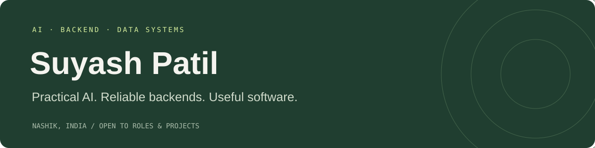

  

  <h2>Hi, I’m Suyash.</h2>
  
<strong>AI &amp; Python Backend Engineer · Nashik, India</strong>

  
I build practical AI applications, reliable backend services, and data systems with validation and reproducibility at their core.

  
<a href="https://suyashp2643.github.io/"><strong>Explore my portfolio ↗</strong></a> &nbsp; · &nbsp; <a href="https://github.com/suyashp2643?tab=repositories">Browse my repositories</a>

---

### Selected engineering work

**[AI Receptionist](https://github.com/suyashp2643/ai-receptionist)**  
A configurable, multi-tenant platform for business enquiries, knowledge retrieval, appointment requests, and human handoff.

- FastAPI backend, PostgreSQL, SQLAlchemy, and a Next.js interface.
- Embeddable streaming widget, browser-native voice, and an operations dashboard.
- Tenant-scoped data access, role-based permissions, and transactional outbox integrations.
- Deterministic mock AI supports development without paid API credentials; real provider adapters require configuration.

**RiskLens — Portfolio Risk Investigation & Replay**  
Python and SQL tooling for investigating data quality, calculating portfolio risk, and reproducing saved reports.

- Immutable snapshots and SHA-256 hashes preserve input provenance.
- Historical VaR and expected shortfall, rolling backtesting, and hypothetical stress scenarios.
- Correction approvals bind parent and proposed input hashes.
- Source code remains private; the portfolio includes a project overview.

**AI Revenue Brain — Real Estate Lead Workflows**  
A private project combining lead context, property matching, next actions, and pipeline analytics.

- FastAPI, PostgreSQL, Next.js, and Redis.
- Conversation and site-visit briefs, dormant lead analysis, and objection analytics.

### Tools I work with

| Area | Technologies |
| --- | --- |
| Languages | Python, SQL, JavaScript, TypeScript |
| Backend | FastAPI, REST APIs, SQLAlchemy, Alembic |
| Data | PostgreSQL, Pandas, data validation, ETL |
| Frontend | React, Next.js, Tailwind CSS |
| AI | LLM integration, retrieval, provider abstraction |
| Engineering | PyTest, Git, Linux, Redis |

### Background

B.E. in Artificial Intelligence & Data Science, DY Patil College of Engineering, Akurdi. Internship experience in AI/ML at Tekhnologia Innovations and web development at Prodigy Infotech.

### Let’s work together

I’m open to **AI engineering and Python backend roles**, remote work, relocation, and freelance projects involving business applications, APIs, and workflow automation.

Explore the linked AI Receptionist repository for architecture, security notes, and local setup instructions.
