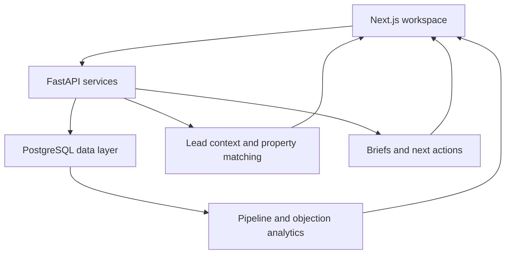

# AI Revenue Brain — Real Estate Lead Workflows

[← Profile](../README.md) · [Portfolio](https://suyashp2643.github.io/#revenue) · [Discuss the workflow](mailto:suyash.p346@gmail.com?subject=Revenue%20Brain%20walkthrough)

**FastAPI · PostgreSQL · SQLAlchemy · Alembic · Next.js · Tailwind · Redis**  
**Source:** private. No client records or implementation secrets are included here.

## The problem

Lead information can be fragmented across conversations, spreadsheets, and follow-up notes. AI Revenue Brain brings context, property matching, and next actions into a real estate workspace.

## Application structure

The diagram summarises the application layers. It is not a deployment or infrastructure claim.

## Workflows

| Workflow | Application behaviour |
| --- | --- |
| Lead prioritisation | Examine context, intent signals, and next actions |
| Property matching | Bring relevant property information into the lead workflow |
| Call and site-visit preparation | Build briefs from available lead and conversation context |
| Dormant lead investigation | Review inactive lead patterns and follow-up opportunities |
| Objection analysis | Examine objections alongside pipeline activity |

## Engineering decisions

**Separate the API and interface.** FastAPI owns backend workflows, while Next.js presents the workspace. This keeps the interface separate from service and data-layer logic.

**Demonstrate with seeded records.** Seeded leads let the application be explored without publishing client records. Demonstration counts are not customer results.

**Keep the next action close to context.** A useful workflow should connect analysis with a task an operator can actually perform.

## Scope and evidence

This is an engineering project. No production customer count, conversion uplift, or revenue improvement is claimed. The portfolio's lead-flow graphic is an illustration rather than an application screenshot.

A useful walkthrough follows one lead through context review, matching, a preparation brief, and a next action. Public screenshots can be added after any sensitive information has been removed.
