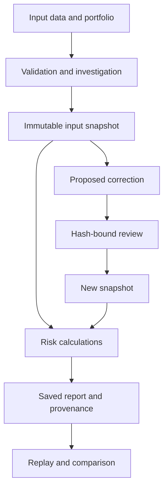

# RiskLens — Portfolio Risk Investigation & Replay

[← Profile](../README.md) · [Portfolio](https://suyashp2643.github.io/#risklens) · [Discuss the implementation](mailto:suyash.p346@gmail.com?subject=RiskLens%20implementation)

**Python · PostgreSQL · Pandas · SQLAlchemy · Alembic · PyTest**  
**Source:** private. This document describes the project without publishing implementation code or credentials.

## The problem

A risk number is difficult to investigate when the underlying prices, portfolio configuration, or correction history have changed. RiskLens connects validation, calculation, investigation, and report replay so that a result can be traced to its inputs.

## System design

This is a conceptual workflow, not a screenshot of a production deployment.

## Implementation highlights

| Concern | Approach | Why it matters |
| --- | --- | --- |
| Reproducibility | Immutable input snapshots, content hashes, report configuration, and engine metadata | A saved result can be traced and replayed |
| Data quality | Checks for missing, duplicate, invalid, unchanged, and unusually large price movements | Investigations start from structured evidence |
| Correction review | Approvals bind parent snapshot and proposed input hashes | A decision applies to the reviewed inputs |
| Risk analytics | Portfolio returns, volatility, drawdown, historical VaR, and expected shortfall | Calculations have explicit conventions |
| Backtesting | Rolling forecasts use returns preceding each evaluation date | Evaluation avoids including the return being tested |
| Stress analysis | Hypothetical instrument and sector shocks with overlap and coverage rules | Contributions can be examined explicitly |

## Decisions worth discussing

**Retain inputs rather than depend on the upstream source.** This adds storage and metadata, but prevents later source changes from silently altering a replay.

**Keep corrections explicit.** A corrected snapshot is a new record. Binding approvals to hashes adds workflow complexity but preserves what was actually reviewed.

**Separate historical estimates from hypothetical scenarios.** VaR backtesting and stress calculations answer different questions and need different interpretation.

## Validation boundaries

- Return, quantile, drawdown, and calculation edge cases.
- Invalid input captures and structured investigation evidence.
- Replay reproducibility and configuration compatibility.
- Approval binding and immutable records.
- Forecast training-window boundaries and strictly greater-than VaR exceptions.

These describe project testing areas. This documentation update did not execute the private project's tests; no new passing-test count is asserted here.

## Scope

Historical VaR and stress scenarios are investigation tools, not forecasts of future losses. A statistical coverage test does not establish that a model is reliable. Source code and internal records remain private.

For a walkthrough, ask about a missing-price investigation, an approved correction, and the resulting report comparison.
